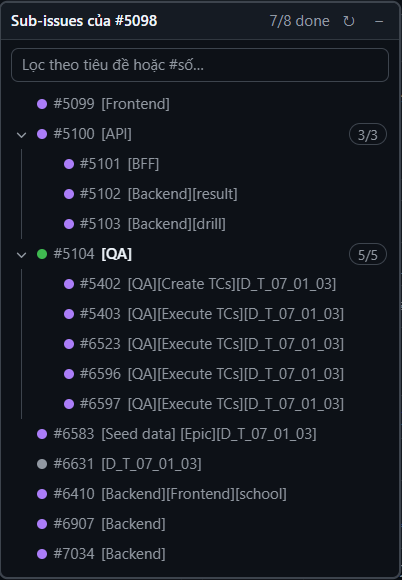

# GitHub Sub-issue Navigator

Menu nổi bên trái hiện cây sub-issue của issue đang mở trên GitHub; click để mở nhanh.

## Cài đặt (Chrome)
1. Vào https://github.com/truongbt-0855/gh-toolkit → nút xanh **Code** → **Download ZIP** → giải nén.
2. Mở Chrome, gõ `chrome://extensions` vào thanh địa chỉ.
3. Bật **Developer mode** (góc trên bên phải).
4. Bấm **Load unpacked** → chọn thư mục vừa giải nén (thư mục có file `manifest.json`).
5. Mở một issue có sub-issue trên GitHub là thấy menu.

⚠️ Đừng xoá thư mục đã giải nén, xoá là extension mất.
Cập nhật bản mới: tải ZIP lại, giải nén đè lên thư mục cũ, rồi bấm ↻ ở extension trong `chrome://extensions`.

## Tính năng
Chỉ hiện ở issue có sub-issue. Hoạt động ở:
- Trang issue thường: `github.com/owner/repo/issues/123`
- Pane issue trong Project: `.../projects/39/views/4?pane=issue&issue=owner|repo|123`

List hiển thị đúng cây phân cấp như panel Sub-issues của GitHub: thụt lề + đường kẻ theo level, mũi tên ▸ để
mở/đóng nhánh con (bấm vào đây sẽ mở/đóng luôn nhánh đó trong panel của GitHub, vì sub-issue con chỉ có trong
trang khi nhánh đang mở), badge `1/2` = tiến độ sub-issue con.
Nhánh mở/đóng ngay khi bấm, có animation: lần đầu mở hiện dòng "Đang tải…" trong lúc GitHub load con,
các lần sau lấy từ cache nên sổ ra liền.
Title chỉ hiện các prefix `[...]` tiếng Anh/Việt ở đầu, bỏ prefix tiếng Nhật
(`[Seed data] [CR][機能名] タイトル…` → `[Seed data] [CR]`); rê chuột để xem title đầy đủ, ô lọc vẫn tìm theo title đầy đủ.

Click sub-issue ở trang issue → mở trong side panel của GitHub (`/owner/repo/issues/123?issue=owner|repo|456`),
list vẫn giữ cây của issue cha và tô sáng sub-issue đang mở. Ở Project → mở trong pane của Project.
Ctrl/⌘+click hoặc chuột giữa → mở trang của chính issue đó (`/owner/repo/issues/456`) ở tab mới.
Chấm xanh = open, tím = closed, xám = not planned.
Kéo header để di chuyển, nút `–` để thu gọn; vị trí & trạng thái được nhớ.

Dev: `git clone` repo rồi Load unpacked thư mục clone; cập nhật bằng `git pull` + ↻. Edge dùng `edge://extensions`.

## Cách hoạt động
Extension **đọc DOM** của panel "Sub-issues" mà GitHub đã render, không gọi API → không cần token,
chạy được với repo private/SSO, không gửi dữ liệu đi đâu. Đổi lại: nếu GitHub đổi markup thì cần sửa
`findSubIssueSection()` / `collectSubIssues()` trong `content.js`.
Khi side panel đang mở, trang có 2 khối Sub-issues; extension lấy khối của issue có số khớp với URL (đọc từ `issue-header`).
Nếu issue có sub-issue mà panel không hiện → F5 trang (panel sub-issue của GitHub load chậm hơn body).
